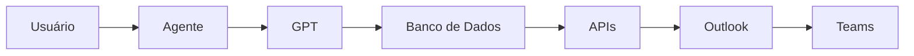
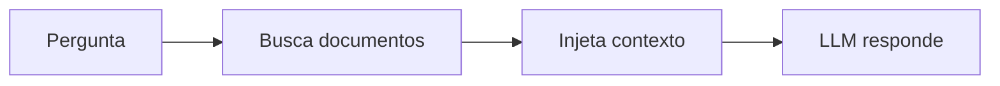
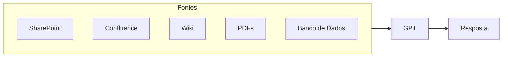
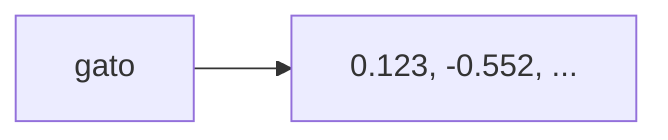
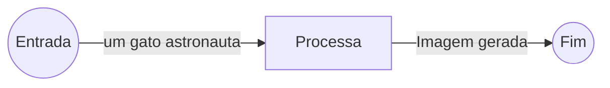
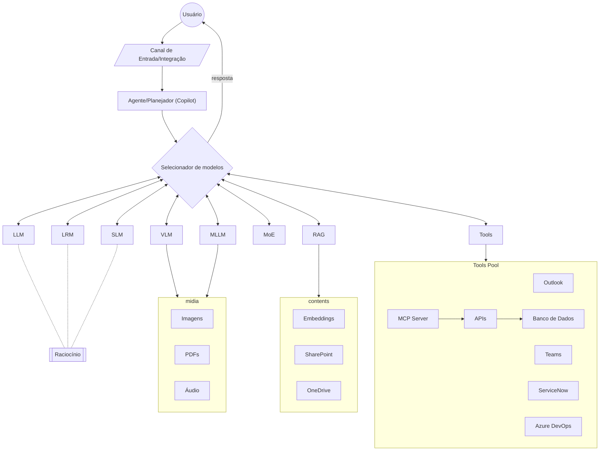

Esse universo evoluiu rápido e hoje existem vários termos parecidos. Abaixo está uma visão prática do que cada um significa.

## 1\. LLM (Large Language Model)

É o termo mais conhecido.

Um **LLM** é um modelo de linguagem treinado com enormes volumes de texto e normalmente possui bilhões ou trilhões de parâmetros.

Características:

- Grande capacidade de raciocínio geral
- Conhecimento amplo
- Consegue realizar muitas tarefas sem treinamento específico
- Alto consumo de GPU, RAM e energia

Exemplos:

| Modelo         |        Parâmetros |
| -------------- | ----------------: |
| Llama 3.1 8B   |         8 bilhões |
| Qwen 3 32B     |        32 bilhões |
| GPT-5          |     não divulgado |
| Claude Opus    |     não divulgado |
| Gemini 2.5 Pro |     não divulgado |
| DeepSeek R1    | 671 bilhões (MoE) |

Analogia:

> Um LLM é como um especialista generalista que leu milhões de livros.

## 2\. SLM (Small Language Model)

É um modelo pequeno, otimizado para rodar localmente ou em hardware limitado.

Características:

- Menor custo
- Menor consumo de memória
- Menor latência
- Pode rodar em notebook ou smartphone
- Conhecimento e raciocínio normalmente inferiores aos LLMs

Exemplos:

| Modelo       | Tamanho |
| ------------ | ------: |
| Phi-4 Mini   |     ~4B |
| Gemma 3 4B   |      4B |
| Llama 3.2 3B |      3B |
| Qwen 2.5 3B  |      3B |

Analogia:

> Um SLM é como um técnico especializado em vez de um professor universitário.

## 3\. LRM (Large Reasoning Model)

Novo conceito que apareceu após modelos como OpenAI o1, o3, DeepSeek-R1 e Claude Thinking.

O foco não é apenas linguagem, mas **raciocínio explícito**.

Características:

- Executa passos internos antes da resposta
- Resolve problemas complexos
- Faz planejamento
- Usa cadeias de raciocínio
- Mais lento e mais caro

Exemplos:

| Modelo                  |
| ----------------------- |
| OpenAI o1               |
| OpenAI o3               |
| DeepSeek R1             |
| Gemini 2.5 Pro Thinking |
| Claude Sonnet Thinking  |
| Claude Opus Thinking    |

Analogia:

> Um LLM responde rápido.
>
> Um LRM para, pensa, faz contas e depois responde.

## 4\. VLM (Vision Language Model)

Combina linguagem e visão.

Entrada:

- Texto
- Imagens
- PDFs
- Diagramas

Saída:

- Texto
- Análise visual

Exemplos:

| Modelo        |
| ------------- |
| GPT-5 Vision  |
| Gemini 2.5    |
| Claude Vision |
| Qwen-VL       |
| LLaVA         |

Uso:

- Ler telas
- Interpretar gráficos
- OCR
- Analisar diagramas

## 5\. MLLM (Multimodal Large Language Model)

Evolução do VLM.

Aceita múltiplos tipos de entrada:

- Texto
- Imagem
- Áudio
- Vídeo

Exemplos:

| Modelo     |
| ---------- |
| GPT-5      |
| Gemini 2.5 |
| Claude 4   |
| Qwen Omni  |

## 6\. MoE (Mixture of Experts)

Não é um tipo de IA, mas uma arquitetura.

A ideia:

- Possui vários "especialistas"
- Apenas alguns são ativados por consulta

Exemplo simplificado:

```text
Especialista 1 => matemática
Especialista 2 => programação
Especialista 3 => medicina
Especialista 4 => direito
```

A pergunta entra.

Um "roteador" escolhe quais especialistas usar.

Exemplos:

| Modelo      |
| ----------- |
| DeepSeek R1 |
| DeepSeek V3 |
| Mixtral     |
| Grok 4      |

Vantagem:

- Parece enorme
- Consome menos recursos por consulta

## 7\. Agentic Model (Agente)

Não é um modelo.

É um sistema que usa um modelo.

Possui:

- LLM
- Ferramentas
- Memória
- Planejamento
- Execução de ações

Exemplo:



Exemplos:

- Microsoft 365 Copilot
- Copilot Studio Agents
- OpenAI Operator
- Manus
- Claude Computer Use

## 8\. RAG (Retrieval Augmented Generation)

Também não é um modelo.

É uma técnica.

Fluxo:



Muito usada em empresas.

Exemplo:



Você provavelmente usa isso diariamente no Microsoft 365 Copilot.

## 9\. Foundation Model

Modelo-base.

É o modelo "cru", antes de especializações.

Exemplos:

| Foundation Model |
| ---------------- |
| GPT-5            |
| Claude Opus      |
| Gemini           |
| Llama            |
| Qwen             |

Depois dele podem ser criados:

- Chatbots
- Agentes
- Copilots
- Classificadores
- Sistemas de busca

## 10\. Embedding Model

Não gera texto.

Transforma texto em vetores numéricos.

Exemplo:



Usado para:

- Busca semântica
- RAG
- Similaridade
- Recomendação

Exemplos:

| Modelo                 |
| ---------------------- |
| text-embedding-3-large |
| BGE                    |
| E5                     |
| GTE                    |
| Nomic Embed            |

## 11\. Diffusion Model

Não é LLM.

Gera imagens.

Exemplos:

| Modelo           |
| ---------------- |
| Stable Diffusion |
| Flux             |
| DALL-E           |
| Imagen           |
| Midjourney       |



## 12\. World Model

Uma das tendências mais importantes para 2027-2030.

Objetivo:

Criar um modelo que entenda:

- física
- espaço
- tempo
- causalidade
- planejamento

Mais próximo de um "simulador do mundo".

Exemplos em pesquisa:

- Sora
- Genie (Google)
- Cosmos (NVIDIA)
- World Models da Meta

## Resumo rápido

| Sigla            | Nome                           | Principal função               |
| ---------------- | ------------------------------ | ------------------------------ |
| LLM              | Large Language Model           | Linguagem geral                |
| SLM              | Small Language Model           | Linguagem leve                 |
| LRM              | Large Reasoning Model          | Raciocínio avançado            |
| VLM              | Vision Language Model          | Texto + imagem                 |
| MLLM             | Multimodal LLM                 | Texto + imagem + áudio + vídeo |
| MoE              | Mixture of Experts             | Arquitetura eficiente          |
| RAG              | Retrieval Augmented Generation | Consulta documentos            |
| Agent            | Sistema com ferramentas        | Executa ações                  |
| Foundation Model | Modelo base                    | Origem de outros sistemas      |
| Embedding Model  | Vetorização                    | Busca semântica                |
| Diffusion Model  | Geração visual                 | Imagens                        |
| World Model      | Modelagem do mundo             | Planejamento e simulação       |

Para alguém trabalhando com **Copilot, MCP Server, RAG e agentes corporativos**, uma arquitetura moderna normalmente fica assim:



Ou seja, hoje o "cérebro" costuma ser um **LLM ou LRM**, enquanto o sistema completo envolve também **RAG, Embeddings, Agentes e Ferramentas**. Isso explica por que um Microsoft 365 Copilot é muito mais do que apenas um modelo de IA.
