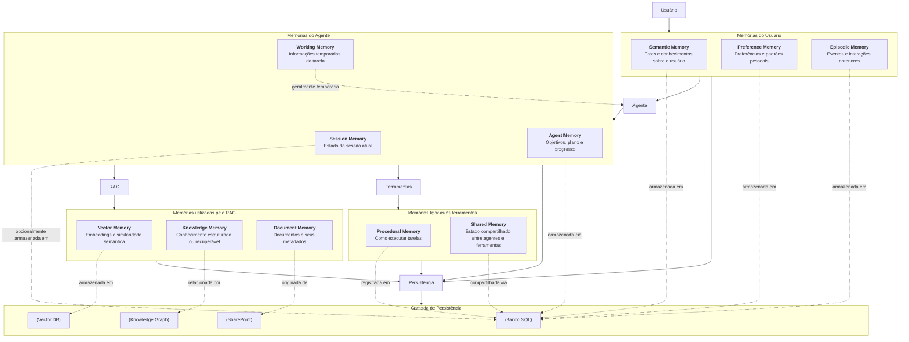
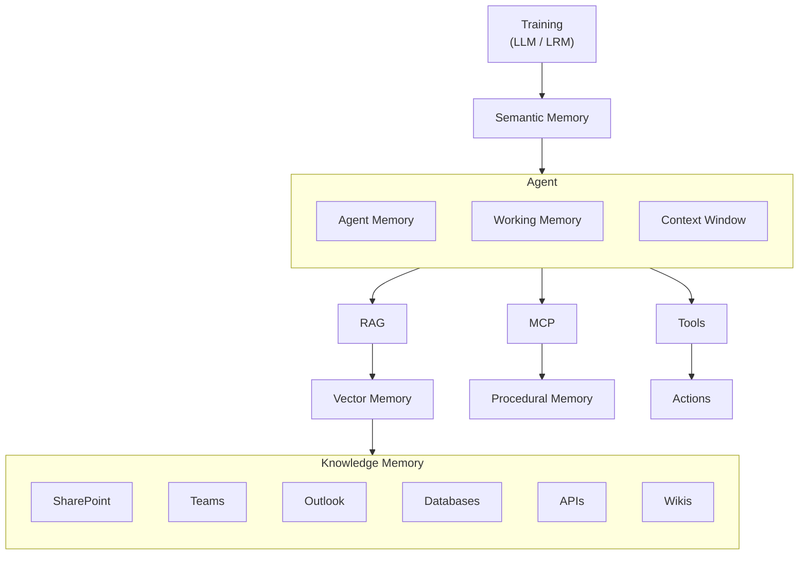
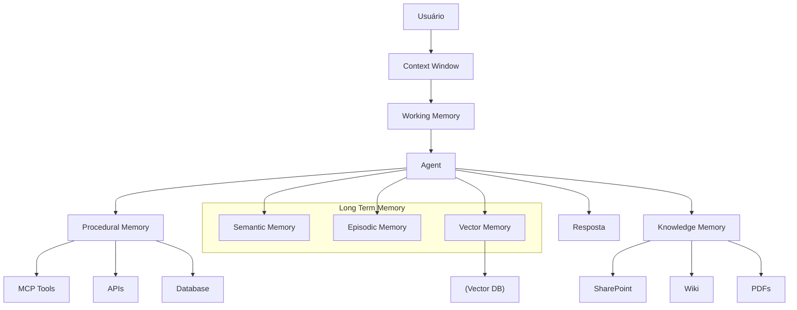

# Memória em IA

Memória é um dos conceitos mais confusos em IA porque existem **várias camadas de memória**, desde o nível do modelo até o nível do agente.

| Tipo de Memória            | O que guarda                     | Equivalente Humano      | Volatilidade           | Onde costuma ficar             | Exemplo                                   |
| -------------------------- | -------------------------------- | ----------------------- | ---------------------- | ------------------------------ | ----------------------------------------- |
| **Context Window**         | Conversa atual                   | Memória de curto prazo  | Segundos/minutos       | Prompt/contexto do LLM         | "Meu nome é Helbert"                      |
| **Working Memory**         | Cálculos e raciocínio temporário | Memória de trabalho     | Milissegundos/segundos | Estado interno da inferência   | Resolver 125 × 37                         |
| **Conversational Memory**  | Histórico recente da conversa    | Lembrança da conversa   | Horas/dias             | Histórico de chat              | "Continuando o assunto anterior..."       |
| **Episodic Memory**        | Eventos específicos              | Memória episódica       | Meses/anos             | Banco de memória               | "Em outubro você estava migrando MariaDB" |
| **Semantic Memory**        | Fatos permanentes                | Conhecimento geral      | Anos                   | Perfil persistente             | "Helbert trabalha com telecom"            |
| **Preference Memory**      | Preferências pessoais            | Hábitos                 | Anos                   | Perfil do usuário              | "Usar INT UNSIGNED para IDs"              |
| **Vector Memory**          | Embeddings semânticos            | Associação de ideias    | Anos                   | Vector DB                      | Buscar conteúdos sobre MCP                |
| **Knowledge Memory**       | Conhecimento organizacional      | Biblioteca              | Anos                   | SharePoint, Wiki, Confluence   | Manual de um sistema                      |
| **Procedural Memory**      | Como executar tarefas            | Memória procedural      | Anos                   | Skills, ferramentas, workflows | Abrir ticket ServiceNow                   |
| **Agent Memory**           | Estado de um plano               | Lista mental de tarefas | Horas/dias             | Estado do agente               | Tarefa 2 concluída, tarefa 3 pendente     |
| **Shared Memory**          | Contexto compartilhado           | Trabalho em equipe      | Variável               | Banco compartilhado            | Vários agentes colaborando                |
| **Persistent Memory**      | Tudo que deve sobreviver         | Memória de longo prazo  | Permanente             | Banco de dados                 | Perfil completo do usuário                |
| **Cache Memory**           | Resultados recentes              | Lembrança imediata      | Minutos/horas          | Redis, memória RAM             | Consulta repetida                         |
| **Knowledge Graph Memory** | Entidades e relações             | Rede de conhecimento    | Anos                   | Grafo de conhecimento          | Helbert → trabalha em → TIM               |
| **Document Memory**        | Documentos completos             | Arquivo físico          | Anos                   | Filesystem, SharePoint         | PDF de arquitetura                        |
| **Session Memory**         | Estado da sessão atual           | Contexto da reunião     | Horas                  | Sessão do agente               | Parâmetros da consulta atual              |

## Matriz Memória × Tecnologia

| Tipo de Memória       | Aprendizado Inicial | RAG                   | MCP             | API             | SharePoint | Outlook        | Teams          | Agent     | Plugins   | Skills    | Instructions      | Hooks           | Tools           |
| --------------------- | ------------------- | --------------------- | --------------- | --------------- | ---------- | -------------- | -------------- | --------- | --------- | --------- | ----------------- | --------------- | --------------- |
| Context Window        | Principal           | Apenas Alimenta       |                 |                 |            |                |                | Usa       |           |           | Alimenta          | Pode alterar    | Alimenta        |
| Working Memory        | Interna             |                       |                 |                 |            |                |                | Principal |           |           | Apenas Influencia | Pode enriquecer | Pode enriquecer |
| Conversational Memory |                     | Apenas Pode recuperar |                 |                 |            |                | Chats          | Principal |           |           |                   |                 |                 |
| Episodic Memory       |                     | Sim                   | Sim             | Sim             | Sim        | Sim            | Sim            | Sim       | Sim       | Sim       |                   | Sim             | Sim             |
| Semantic Memory       | Principal           | Sim                   | Sim             | Sim             | Sim        | Apenas Parcial | Apenas Parcial | Sim       | Talvês    | Sim       | Sim               |                 |                 |
| Preference Memory     |                     | Sim                   | Sim             | Sim             |            |                |                | Sim       |           | Sim       | Principal         | Sim             | Talvês          |
| Vector Memory         |                     | Principal             | Apenas Consulta | Apenas Consulta | Origem     | Origem         | Origem         | Usa       |           |           |                   |                 |                 |
| Knowledge Memory      | Treinamento         | Principal             | Acesso          | Acesso          | Principal  | Fonte          | Fonte          | Consome   | Consome   | Consome   |                   |                 |                 |
| Procedural Memory     |                     |                       | Principal       | Principal       |            |                |                | Sim       | Principal | Principal | Sim               | Sim             | Principal       |
| Agent Memory          |                     |                       | Compartilha     | Compartilha     |            |                |                | Principal | Sim       | Sim       | Apenas Influencia | Principal       | Sim             |
| Shared Memory         |                     | Talvês                | Principal       | Sim             |            |                | Sim            | Sim       | Sim       | Sim       |                   | Sim             | Sim             |
| Persistent Memory     | Pesos               | Vetores               | Estado          | Estado          | Principal  | Principal      | Principal      | Principal | Sim       | Sim       | Sim               | Sim             | Sim             |

## Memória por camada

| Camada               | Memórias típicas                                    |
| -------------------- | --------------------------------------------------- |
| **Modelo (LLM/LRM)** | Context Window, Working Memory                      |
| **Agente**           | Agent Memory, Session Memory                        |
| **Usuário**          | Semantic Memory, Preference Memory, Episodic Memory |
| **RAG**              | Vector Memory, Knowledge Memory, Document Memory    |
| **Organização**      | SharePoint, Wikis, Bancos de Dados, Knowledge Graph |
| **Infraestrutura**   | Cache, Persistent Storage                           |

## Memória por Produto

| Produto               | Memórias mais importantes         |
| --------------------- | --------------------------------- |
| ChatGPT               | Context, Semantic, Episodic       |
| Microsoft 365 Copilot | Context, RAG, Knowledge, Semantic |
| Copilot Studio Agent  | Agent, Procedural, RAG, Shared    |
| Perplexity            | Context, Vector, Knowledge        |
| Claude                | Context, Semantic, Working        |
| MCP Server            | Procedural, Agent, Knowledge      |
| CrewAI / AutoGen      | Agent, Shared, Procedural         |
| NotebookLM            | Knowledge, Document, Vector       |

## Quem "cria" cada memória?

| Componente            | Cria                | Lê         | Atualiza |
| --------------------- | ------------------- | ---------- | -------- |
| Treinamento do Modelo | Semantic            | Semantic   | Não      |
| RAG                   | Vector / Knowledge  | Vector     | Sim      |
| SharePoint            | Knowledge           | Knowledge  | Sim      |
| Outlook               | Episodic            | Episodic   | Sim      |
| Teams                 | Episodic            | Episodic   | Sim      |
| MCP                   | Procedural / Agent  | Todas      | Sim      |
| APIs                  | Episodic / Semantic | Todas      | Sim      |
| Agent                 | Agent Memory        | Todas      | Sim      |
| Plugins               | Procedural          | Procedural | Sim      |
| Skills                | Procedural          | Procedural | Sim      |
| Instructions          | Preference          | Preference | Sim      |
| Hooks                 | Agent / Workflow    | Agent      | Sim      |
| Tools                 | Procedural          | Procedural | Sim      |

## Copilot corporativo

      Usuário
         │
         ├─ Semantic Memory
         ├─ Preference Memory
         └─ Episodic Memory
      Agente
         │
         ├─ Session Memory
         ├─ Agent Memory
         └─ Working Memory
      RAG
         │
         ├─ Vector Memory
         ├─ Knowledge Memory
         └─ Document Memory
      Ferramentas
         │
         ├─ Procedural Memory
         └─ Shared Memory
      Persistência
         │
         ├─ Banco SQL
         ├─ Vector DB
         ├─ SharePoint
         └─ Knowledge Graph

## Mapeamento para Microsoft 365 Copilot  

| Conceito          | Onde fica                                          |
| ----------------- | -------------------------------------------------- |
| Context Memory    | Conversa atual                                     |
| Semantic Memory   | Perfil do usuário                                  |
| Preference Memory | Memories salvas do usuário                         |
| Episodic Memory   | Emails, reuniões, chats                            |
| Knowledge Memory  | SharePoint, OneDrive, Teams, Wiki                  |
| Vector Memory     | Índices semânticos do Microsoft Graph              |
| Procedural Memory | Plugins, Skills, MCP, Actions                      |
| Agent Memory      | Estado do agente durante execução                  |
| Persistent Memory | Microsoft Graph + bancos + armazenamento do agente |

         Treinamento       → Semantic Memory
         RAG               → Knowledge + Vector Memory
         Agent             → Agent + Working Memory
         MCP/Tools/Skills  → Procedural Memory
         SharePoint/Teams  → Knowledge Memory
         Emails/Reuniões   → Episodic Memory
         Instructions      → Preference Memory
         Banco de Dados    → Persistent Memory

## 1\. Context Window (Memória de Curto Prazo)

É a mais básica, o modelo só "enxerga" o que está dentro da janela de contexto.

Exemplo:

      Usuário:
      Meu nome é Helbert.

      Usuário:
      Qual é meu nome?

      Funciona porque ambas as mensagens estão na janela.
      Se a conversa crescer demais:

      mensagem 1
      ...
      mensagem 5000

      A mensagem 1 pode sair do contexto.
      O modelo "esquece".

## 2\. Working Memory (Memória de Trabalho)

Equivalente ao raciocínio temporário.

Durante a resposta o modelo cria estados intermediários.

Exemplo:

      125 \* 37

      O LRM pode internamente fazer:

      125 \* 30 = 3750

      125 \* 7 = 875

      3750 + 875 = 4625

      Essa memória desaparece ao terminar a resposta.

## 3\. Conversational Memory (Memória Conversacional)

Mantém o histórico de diálogos.

Exemplo:

      Usuário:
      Estou projetando um MCP Server.

      ...

      Usuário:
      Como autenticar isso?

      O sistema entende que "isso" é o MCP Server.

Muito usada por:

- ChatGPT
- Claude
- Copilot
- Gemini

## 4\. Episodic Memory (Memória Episódica)

Armazena eventos específicos.

Exemplo:

      14/10/2026

      Usuário:
      Estou migrando MariaDB para Oracle.

      Meses depois:

      Você ainda trabalha com aquela migração?

      O sistema lembra do evento.

Estrutura típica:

{
  "date":"2026-10-14",
  "event":"Migração MariaDB -> Oracle"
}

## 5\. Semantic Memory (Memória Semântica)

Armazena fatos sobre o usuário.

Exemplo:

      Helbert trabalha com:
      - Telecom
      - MariaDB
      - eVoice
      - MCP

      Não importa quando foi dito.

      Importa que é conhecimento duradouro.

      É exatamente o tipo de memória que estou usando sobre você nesta conversa.

Exemplo:

{
  "user":"Helbert",
  "skills":\[
      "MariaDB",
      "Telecom",
      "MCP",
      "Python"
  \]
}

## 6\. Long-Term Memory

Combina:

- Memória episódica
- Memória semântica
- Vetores

Pode durar anos.

Exemplo:

Usuário:
Sempre use INT UNSIGNED para ids.

Isso pode ser guardado como preferência permanente.

## 7\. Vector Memory

Muito usada em RAG.

O texto é transformado em embeddings:

MCP
→ vetor

Copilot
→ vetor

MariaDB
→ vetor

Quando você pergunta:

Como autenticar um MCP?

O sistema localiza memórias semanticamente parecidas.

Arquitetura típica:

Texto
  ↓
Embedding
  ↓
Vector DB
  ↓
Busca Semântica

## 8\. Knowledge Memory

Conhecimento corporativo.

Exemplos:

- SharePoint
- Confluence
- Wiki
- DevOps Wiki
- PDFs

Não é memória do usuário.

É memória da organização.

Copilot
 ↓
SharePoint
 ↓
Contrato.pdf

## 9\. Procedural Memory

Equivalente ao "saber fazer".

Exemplo humano:

andar de bicicleta

Exemplo IA:

abrir ticket
consultar API
executar SQL
enviar email

Normalmente implementado como:

- Skills
- Plugins
- Ferramentas
- MCP Tools

## 10\. Agent Memory

Usada por agentes complexos.

Guarda:

- Objetivos
- Plano
- Estado atual
- Próximas ações

Exemplo:

{
  "goal":"Criar relatório",
  "completed":\[
     "Buscar dados"
  \],
  "pending":\[
     "Gerar gráfico",
     "Enviar email"
  \]
}

Muito comum em:

- CrewAI
- AutoGen
- Copilot Studio
- OpenAI Operator

## 11\. Shared Memory

Memória compartilhada entre agentes.

Exemplo:

Agente A
 ↓
Memória Compartilhada
 ↓
Agente B

Usada em arquiteturas multiagentes.

## 12\. Persistent Memory

Memória realmente permanente.

Exemplos:

Preferências
Projetos
Perfil
Relacionamentos

Armazenada em:

- SQL
- CosmosDB
- PostgreSQL
- Redis
- Vector DB

## Arquitetura completa

### Resumo executivo

| Tipo                  | O que guarda             | Duração          |
| --------------------- | ------------------------ | ---------------- |
| Context Window        | Conversa atual           | Segundos/minutos |
| ---                   | ---                      | ---              |
| Working Memory        | Raciocínio temporário    | Resposta atual   |
| Conversational Memory | Histórico da conversa    | Horas/dias       |
| Episodic Memory       | Eventos                  | Meses/anos       |
| Semantic Memory       | Fatos sobre usuário      | Anos             |
| Vector Memory         | Embeddings               | Anos             |
| Knowledge Memory      | Conteúdo corporativo     | Anos             |
| Procedural Memory     | Como executar tarefas    | Anos             |
| Agent Memory          | Estado do plano          | Horas/dias       |
| Shared Memory         | Troca entre agentes      | Variável         |
| Persistent Memory     | Tudo que deve sobreviver | Permanente       |

Uma forma moderna de enxergar uma IA corporativa é:

LLM = cérebro

Context Window = memória de curto prazo

RAG = memória corporativa

Vector DB = memória associativa

Agent Memory = memória de execução

Semantic Memory = perfil do usuário

MCP/Skills = memória procedural

É exatamente assim que plataformas modernas como Microsoft 365 Copilot, Copilot Studio Agents, ChatGPT Enterprise, Claude Enterprise e arquiteturas MCP corporativas costumam ser estruturadas.
