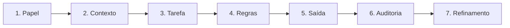
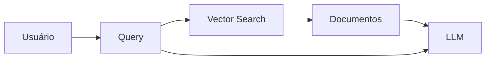

# Engenharia de Prompt

## Resumo Rápido (Passo a Passo)

Se você quiser aprender Engenharia de Prompt rapidamente, siga este fluxo:



1. **Papel (Role Prompting)**: Defina o papel da IA

   Define quem a IA é.
   Quanto mais específico o papel, melhor.

   Exemplos:

   - Você é um engenheiro de telecom especialista em IMS.
   - Você é um DBA Oracle/MariaDB.
   - Você é um arquiteto de soluções Azure.

2. **Contexto (Context Prompting)**: Forneça contexto

   Fornece informações de fundo.
   A IA trabalha melhor com contexto.

   - ❌ Analise esse log.
   - ✅ Analise esse log SIP do Session Router da Empresa e identifique falhas de roteamento, loops ou erros 4xx e 5xx.
   - ✅ O ambiente possui 4 SRs, 20 milhões de chamadas por dia, SBC Oracle..

3. **Tarefa (Task Prompting)**: Defina o objetivo

   Define claramente a tarefa.
   Identifique gargalos.
   Antes de escrever qualquer prompt, responda:

   - O que quero obter?
   - Qual é o resultado esperado?
   - Quem vai usar a resposta?

   Exemplo:

   - ❌ Me fale sobre redes.
   - ✅ Explique NWDAF em redes 5G para um engenheiro de core mobile com exemplos práticos.

4. **Regras (Constraint Prompting)**: Defina restrições

   Define limites, critérios e/ou restrições.

   Exemplo:

   - Não invente informações
   - Cite fontes quando possível
   - Limite a resposta a 20 linhas
   - Considere somente MariaDB
   - Não use cloud.

5. **Saída (Output Prompting)**: Defina formato de saída

   Define formato.

   - Exemplos:
     1. Responda em tabela Markdown contendo:
        - Problema
        - Impacto
        - Causa
        - Solução
     2. Responda em lista numerada contendo:
        - Item 1
        - Item 2
        - Item 3
     3. Retorne JSON válido.

6. **Auditoria (Evaluation Prompting)**: Peça raciocínio e/ou evidências

   Peça raciocínio e autoavaliação.

   Exemplos:

   1. Explique passo a passo como chegou na resposta.
   2. Mostre sua linha de raciocínio de forma resumida.
   3. Forneça evidências que suportem sua resposta com links ou referências de fontes confiáveis.
   4. Revise sua resposta procurando erros.

7. **Refinamento (Refinement Prompting)**: Refine sucessivamente

   1. Prompt Engineering é iterativo.
   2. Prompt 1 → Resultado
   3. Prompt 2 → Melhor resultado
   4. Prompt 3 → Excelente resultado

## Anatomia de um Prompt

Um prompt profissional geralmente contém:

\[Papel + Contexto + Tarefa + Regras + Formato + Auditoria\]

\[Refinamento\]

Exemplo:

```markdown
Você é um engenheiro de banco de dados especializado em MariaDB.

Temos uma tabela com 5 bilhões de registros particionada por RANGE de datas que pode se repetir.

Gere uma estratégia de particionamento eficiente para esta tabela e crie a query SQL correspondente.

Regras:
- Banco usado será MariaDB.
- Priorizar desempenho para consultas futuras.

Formato de saída:
- Query SQL correspondente.
- Breve explicação da estratégia de particionamento.
- Comandos para gerenciar as partições.
- Sugestões se houver.

Auditoria:
- Analise a estratégia de particionamento proposta e verifique se atende aos critérios de desempenho para consultas futuras.
- Sugira melhorias caso identifique possíveis gargalos.
```

## O que é Engenharia de Prompt

Engenharia de Prompt é a prática de projetar instruções que orientam modelos de IA para produzir respostas mais precisas, consistentes e úteis.

É semelhante a:

- Programação em linguagem natural
- Especificação de requisitos
- Design de interação humano-IA

Na prática:

- Prompt = Programa
- LLM = Interpretador
- Resposta = Resultado

## Como um LLM interpreta um prompt

Em alto nível:

```mermaid
   flowchart LR

      P[Prompt]
      C[Contexto]
      M[Memória]
      I[Instruções]
      R[Raciocínio]

      P --> R
      C --> R
      M --> R
      I --> R

      R --> O[Resposta]
   ```

O modelo combina:

- Prompt atual
- Histórico da conversa
- Instruções do sistema
- Memória disponível
- Conhecimento do modelo
- Dados recuperados (RAG)

## Principais Técnicas

- **Zero-Shot Prompting**: Nenhum exemplo fornecido.

      Explique SIP.

- **One-Shot Prompting**: Um único exemplo fornecido.

      Entrada:
      A

      Saída:
      B

      Entrada:
      C

- **Few-Shot Prompting**: Vários exemplos fornecidos.

      Erro 404 → recurso não encontrado
      Erro 500 → falha interna

      Erro 503 →

- **Chain of Thought (CoT)**: Estimula raciocínio passo a passo.

      Resolva passo a passo.

- **Tree of Thoughts**: Múltiplos caminhos de raciocínio.

      Apresente três hipóteses.
      Avalie vantagens e desvantagens.

- **Self-Consistency**: Gera múltiplas soluções e escolhe a melhor.

      Gere três abordagens.
      Escolha a mais provável.

  - **Reflexion**: O modelo critica sua própria resposta.

         O modelo critica sua própria resposta.

         Revise criticamente sua solução.

  - **ReAct**: Reason + Act

     1. Pense
     2. Pesquise
     3. Conclua

## Prompt Engineering para Agentes

### Estrutura

```mermaid
flowchart TD

   U[Usuário]
   A[Agente]
   T[Tools]
   R[RAG]
   M[Memória]

   A --> T
   A --> R
   A --> M

   T --> A
   R --> A
   M --> A

   A --> U
```

## Agentes utilizam

- Ferramentas
- APIs
- Memórias
- RAG
- Planejamento
- Subagentes

## Engenharia de Contexto

Atualmente é considerada mais importante que Prompt Engineering.

Muitos especialistas afirmam:

> "O problema não é o prompt. O problema é o contexto."

## Context Window

Quantidade máxima de tokens.

Exemplos aproximados:

| Modelo        | Contexto |
| ------------- | -------: |
| GPT-4o        | até 128k |
| Claude Sonnet | até 200k |
| Gemini        |  até 1M+ |
| Qwen 3        | até 128k |
| DeepSeek V3   | até 128k |

## Engenharia de RAG

Um prompt moderno geralmente recebe: `Prompt + Documentos + Memória + Ferramentas`

Fluxo:



## Engenharia de Instruções

**Níveis / Camadas típicas**:
1. **System Prompt**: Você é um assistente.
2. **Instructions**: Não invente dados.
3. **Prompt do usuário**: Resuma o documento.
4. **Ferramentas**: Pesquisar SharePoint
5. **Memória**: Preferências do usuário

## Técnicas Avançadas

- Delimitadores
  - ❌ Ruim:

         Analise o texto abaixo
         Texto...
         Pergunta...

  - ✅ Melhor:

         Analise:

         <texto>
         ...
         </texto>

         Pergunta:
         ...
- XML Prompting
   ```xml
   <context>
   ...
   </context>

   <task>
   ...
   </task>
   ```
- JSON Prompting
   ```json
   {
     "papel":"DBA",
     "tarefa":"otimizar query",
     "saida":"markdown"
   }
   ```
- Structured Output
   ```json
   {
     "problema":"",
     "causa":"",
     "solucao":""
   }
   ```

### Anti-Padrões

- **Prompt Vago**
  ❌ Fale sobre IA.

- **Sem Contexto**
  ❌ O sistema está lento.

- **Objetivos Conflitantes**
  ❌ Seja extremamente detalhado e responda em uma linha.

- **Informação Insuficiente**
  ❌ Me diga o erro sem mostrar erro algum.

### Framework CRAFT

- **C - Context**: Contexto
- **R - Role**: Papel
- **A - Action**: Ação
- **F - Format**: Formato
- **T - Tone**: Tom

Exemplo:

      Contexto:
      Rede IMS.

      Role:
      Especialista Oracle SBC.

      Action:
      Analisar roteamento.

      Format:
      Tabela.

      Tone:
      Técnico.

### Framework RISEN

- **Role**: Papel do agente
- **Instructions**: Instruções para o agente
- **Steps**: Passos a serem seguidos
- **End Goal**: Objetivo final
- **Narrowing**: Foco ou restrição do contexto

Muito usado em agentes.

### Framework CO-STAR

- **Context**: Contexto
- **Objective**: Objetivo
- **Style**: Estilo
- **Tone**: Tom
- **Audience**: Público-alvo
- **Response**: Resposta

Excelente para documentos.

### Prompt Universal

!!! info Formato do Prompt

      Você é um especialista em `ÁREA`.

      Objetivo:
      `TAREFA`

      Contexto:
      `CONTEXTO`

      Passos:
      1. Analise
      2. Explique
      3. Recomende

      Regras:
      - Não invente dados
      - Cite limitações

      Formato:
      |`TABELA / JSON / MARKDOWN`

**Exemplos Práticos**:

1. **DBA MariaDB**

   Você é especialista em MariaDB.

   Analise esta query.

   Contexto:
   Tabela com 5 bilhões de registros.
   Particionamento RANGE por data.

   Avalie:
   - Índices
   - Partições
   - Full Scan
   - Explain Plan

   Retorne em tabela.

2. **Telecom**

   Você é especialista em Session Router.

   Analise o fluxo SIP abaixo.

   Identifique:
   - Loops
   - Failover
   - Balanceamento
   - Causa raiz

   Mostre raciocínio.

3. **Power BI**

   Você é especialista Power BI.

   Explique passo a passo como criar
   uma segmentação temporal entre
   data inicial e data final.

4. **Documentação**

   Você é arquiteto de software.

   Gere documentação Markdown.

   Inclua:
   - Objetivo
   - Arquitetura
   - Fluxos
   - APIs
   - Banco de dados

Utilize tabelas sempre que possível.

## Resumo Final

A maturidade atual da Engenharia de Prompt pode ser vista em 4 níveis:

| Nível | Foco                                             |
| ----- | ------------------------------------------------ |
| 1     | Escrever prompts                                 |
| 2     | Estruturar instruções                            |
| 3     | Gerenciar contexto                               |
| 4     | Construir agentes com memória, ferramentas e RAG |

Hoje, os melhores resultados normalmente vêm da combinação:

`Prompt + Contexto + Memória + RAG + Ferramentas + Agentes + Avaliação`

> Engenharia de Prompt é a arte de controlar o comportamento de uma IA por meio de instruções, enquanto Engenharia de Contexto é a arte de fornecer as informações certas para que ela tome as melhores decisões.
